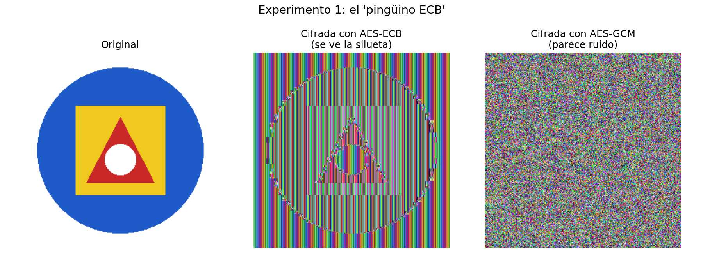
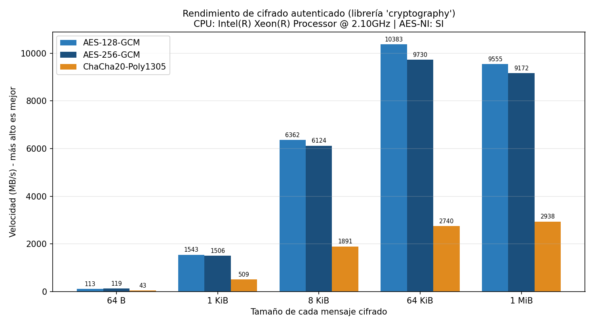

# Algoritmos-AES-CHACHA20

Herramienta de línea de comandos (`cifrador.py`) para **cifrar y descifrar archivos** con
**AES-ECB**, **AES-GCM** y **ChaCha20-Poly1305**, más tres experimentos que demuestran por qué
**el modo de operación importa tanto como el algoritmo**.

> **Idea central:** usar un algoritmo fuerte no basta. AES en modo ECB filtra patrones, y un modo sin
> autenticación no detecta si alguien modificó los datos. Los modos modernos (AES-GCM y
> ChaCha20-Poly1305) cifran **y** autentican.

📘 Hay una guía paso a paso para principiantes en **[`Guia_Paso_a_Paso.pdf`](Guia_Paso_a_Paso.pdf)**
(ideal si nunca has usado estos cifrados).

---

## 1. Contenido del repositorio

```text
Algoritmos-AES-CHACHA20/
├── README.md                       <- este archivo
├── Guia_Paso_a_Paso.pdf            <- guía práctica reproducible para principiantes
├── requirements.txt                <- librerías de Python necesarias
├── .gitignore                      <- evita subir llaves (*.key) por accidente
├── cifrador.py                     <- la herramienta (cifrar / descifrar / generar llave)
├── experimento1_pinguino_ecb.py    <- Experimento 1: ECB vs GCM sobre una imagen
├── experimento2_manipulacion.py    <- Experimento 2: alterar un byte (GCM/ChaCha20 vs CTR/ECB)
├── experimento3_rendimiento.py     <- Experimento 3: rendimiento + gráfico
└── resultados/                     <- salidas de ejemplo (se regeneran al ejecutar)
    ├── exp1/  (logo_original.png, logo_ecb.png, logo_gcm.png, comparacion_ecb_gcm.png)
    ├── exp2/  (resumen.txt y archivos cifrados/alterados de ejemplo)
    └── exp3/  (rendimiento.csv, rendimiento.png, rendimiento_openssl.*)
```

## 2. Requisitos

- Linux (probado en Ubuntu/Debian; en una VM funciona igual), macOS o Windows.
- Python 3.9 o superior.
- Librerías: `cryptography`, `Pillow`, `matplotlib` (están en `requirements.txt`).
- Opcional: `openssl` (para comparar con `openssl speed`).

## 3. Instalación (paso a paso)

```bash
sudo apt update                                  # actualiza la lista de paquetes disponibles
sudo apt install -y python3 python3-venv python3-pip git openssl   # instala Python, venv, pip, git y openssl
git clone https://github.com/TU_USUARIO/Algoritmos-AES-CHACHA20.git   # descarga el proyecto (cambia TU_USUARIO)
cd Algoritmos-AES-CHACHA20                       # entra a la carpeta del proyecto
python3 -m venv .venv                            # crea un entorno virtual aislado (no ensucia tu sistema)
source .venv/bin/activate                        # activa ese entorno (verás (.venv) en la terminal)
pip install -r requirements.txt                  # instala cryptography, Pillow y matplotlib
python3 cifrador.py --version                    # comprueba que todo funciona
```

## 4. Uso de `cifrador.py`

La herramienta tiene tres subcomandos: `generar-llave`, `cifrar` y `descifrar`.

| Opción | Se usa en | Qué hace |
|---|---|---|
| `--modo`, `-m` | todos | `ecb`, `gcm`, `chacha20` (o `chacha20-poly1305`) y `ctr` (solo didáctico). Obligatorio al cifrar; opcional al descifrar (se lee de la cabecera) |
| `--bits` | `generar-llave` | Tamaño de la llave AES: `128`, `192` o `256` (por defecto 256). ChaCha20 siempre usa 256 |
| `--llave`, `-k` | todos | Archivo donde se guarda / de donde se lee la llave |
| `--entrada`, `-i` | `cifrar`, `descifrar` | Archivo de entrada |
| `--salida`, `-o` | `cifrar`, `descifrar` | Archivo de salida (por defecto `<entrada>.enc`, o se quita `.enc` al descifrar) |
| `--forzar` | todos | Permite sobrescribir un archivo que ya existe |

### Ejemplo completo con AES-GCM

```bash
echo "Mensaje muy secreto" > secreto.txt                                        # crea un archivo de prueba
python3 cifrador.py generar-llave --modo gcm --bits 256 --llave mi.key         # crea una llave aleatoria de 256 bits en mi.key
python3 cifrador.py cifrar --modo gcm --llave mi.key -i secreto.txt -o secreto.enc   # cifra secreto.txt -> secreto.enc
python3 cifrador.py descifrar --llave mi.key -i secreto.enc -o recuperado.txt  # descifra y verifica que nadie lo alteró
cat recuperado.txt                                                             # muestra el contenido recuperado
```

### Los tres modos pedidos

```bash
python3 cifrador.py cifrar -m ecb      -k ecb.key  -i secreto.txt -o s_ecb.enc    # AES-ECB (sin autenticación; solo para experimentar)
python3 cifrador.py cifrar -m gcm      -k gcm.key  -i secreto.txt -o s_gcm.enc    # AES-GCM (cifra y autentica)
python3 cifrador.py cifrar -m chacha20 -k chacha.key -i secreto.txt -o s_cha.enc  # ChaCha20-Poly1305 (cifra y autentica)
```

> Antes de cada `cifrar` necesitas haber creado la llave con `generar-llave --modo <el mismo modo> --llave <archivo>`.

### Cómo reporta una manipulación

```bash
python3 cifrador.py descifrar -k mi.key -i secreto_ALTERADO.enc -o x.txt   # intenta descifrar un archivo modificado
echo $?                                                                    # imprime el código de salida del comando anterior
```

```text
[ALERTA] ARCHIVO MANIPULADO O CORRUPTO
         Falló la verificación de autenticidad: el archivo fue MODIFICADO o la llave no es la correcta.
         No se escribió ningún archivo de salida.
2
```

| Código de salida | Significado |
|---|---|
| `0` | Todo bien |
| `1` | Error de uso (archivo o llave inexistente, llave del tamaño incorrecto, modo que no coincide…) |
| `2` | **Archivo manipulado** (solo los modos autenticados pueden detectarlo) |

## 5. Decisiones de diseño (desarrollo de la herramienta)

- **Librería:** [`cryptography`](https://cryptography.io). Es la librería estándar de criptografía en Python, mantenida
  activamente y con API de alto nivel (`AESGCM`, `ChaCha20Poly1305`) que evita errores comunes. Para ECB y CTR se usa su
  capa "primitiva" (`Cipher`, `algorithms.AES`, `modes.ECB`, `modes.CTR`) y `padding.PKCS7` para rellenar bloques.
- **Estructura:** funciones puras (`cifrar_bytes`, `descifrar_bytes`, `generar_llave`…) separadas de la CLI (`argparse`).
  Por eso los experimentos 2 y 3 reutilizan el mismo código sin copiarlo.
- **Llave en archivo separado:** `generar-llave` usa `os.urandom` (generador seguro del sistema operativo), guarda la llave en
  hexadecimal con permisos `600` (solo el dueño) y **se niega a sobrescribir** una llave existente sin `--forzar`, porque
  perderla deja los archivos cifrados irrecuperables.
- **Formato del archivo cifrado:** `"CIFR" | versión | modo | nonce | texto cifrado (+ etiqueta de 16 B en GCM/ChaCha20)`.
  La cabecera de 6 bytes se pasa como *datos asociados* (AAD) en los modos autenticados, así que **también** queda protegida.
- **Nonce:** 12 bytes aleatorios nuevos en cada cifrado (GCM y ChaCha20-Poly1305). Repetir un nonce con la misma llave rompe la
  seguridad, por eso nunca se reutiliza.
- **Detección de manipulación:** si la etiqueta no coincide se lanza `ArchivoManipulado`, se muestra una alerta clara, se sale con
  código `2` y **no se escribe ningún archivo** (para que nadie use datos no verificados por error).
- **ECB y CTR:** existen para los experimentos; la herramienta avisa que no autentican. CTR no estaba en la lista de modos
  pedidos, pero es necesario para el Experimento 2.

## 6. Los tres experimentos

Todos se ejecutan desde la carpeta del proyecto con el entorno virtual activado y guardan su salida en `resultados/`.

### Experimento 1 – El "pingüino ECB" (`experimento1_pinguino_ecb.py`)

```bash
python3 experimento1_pinguino_ecb.py                  # genera un logo de colores planos, lo cifra con ECB y con GCM
python3 experimento1_pinguino_ecb.py --imagen mi.png  # (opcional) usa tu propia imagen en lugar del logo
```

Cifra los **píxeles** (bytes crudos RGB) y reconstruye una imagen con el resultado. Bloques iguales → cifrado ECB igual:
la silueta sigue visible. GCM da ruido sin patrón.



El script también cuenta bloques de 16 bytes únicos: en nuestra corrida, el logo original y su versión ECB tenían **94 bloques
distintos de 12 288**, mientras que GCM tenía **12 288 distintos de 12 288** (ni un solo patrón repetido).

### Experimento 2 – Manipulación (`experimento2_manipulacion.py`)

```bash
python3 experimento2_manipulacion.py   # cifra un mensaje, cambia 1 byte y trata de descifrar (GCM, ChaCha20, CTR y ECB)
```

| Modo | ¿Detecta el cambio de 1 byte? | Qué pasa |
|---|---|---|
| AES-GCM | ✅ Sí | `[ALERTA] ARCHIVO MANIPULADO`, código 2, no se escribe salida |
| ChaCha20-Poly1305 | ✅ Sí | Igual que GCM |
| AES-CTR | ❌ No | Descifra "bien", pero `transferir 100 colones` pasó a **`transferir 900 colones`** |
| AES-ECB | ❌ No | Descifra "bien", pero un bloque de 16 bytes quedó convertido en basura |

En CTR el atacante ni siquiera necesita la llave: como el texto cifrado es `texto ⊕ flujo`, cambiar un byte del cifrado cambia
**exactamente ese byte** del texto claro. El resumen completo queda en `resultados/exp2/resumen.txt`.

### Experimento 3 – Rendimiento (`experimento3_rendimiento.py`)

```bash
grep -o aes /proc/cpuinfo | head -1                  # imprime "aes" si tu CPU tiene AES-NI (aceleración por hardware)
python3 experimento3_rendimiento.py --segundos 3     # mide los 3 algoritmos con 'cryptography' y crea el gráfico
python3 experimento3_rendimiento.py --openssl        # además mide con openssl speed -evp y crea un segundo gráfico
openssl speed -evp aes-256-gcm                       # (manual) benchmark de AES-256-GCM de OpenSSL
openssl speed -evp chacha20-poly1305                 # (manual) benchmark de ChaCha20-Poly1305 de OpenSSL
```



Resultado de ejemplo (MB/s, mensajes de 8 KiB y de 1 MiB) en el equipo donde se prepararon estos archivos
(Intel Xeon 2.10 GHz **con AES-NI**):

| Algoritmo | 8 KiB | 1 MiB |
|---|---|---|
| AES-128-GCM | 6 362 | 9 555 |
| AES-256-GCM | 6 124 | 9 172 |
| ChaCha20-Poly1305 | 1 891 | 2 938 |

**Cómo leerlo:** con AES-NI, AES-GCM es varias veces más rápido que ChaCha20-Poly1305, y AES-256 cuesta apenas ~4 % más que
AES-128. Sin aceleración por hardware (CPUs antiguas, algunos celulares o VMs que no exponen AES-NI) la situación suele
invertirse y ChaCha20-Poly1305 gana. **Tus números serán distintos**: repite el experimento en tu VM y compara
(el gráfico que genera tu máquina es el que debes entregar).

## 7. Notas de seguridad y límites

- Esto es un **proyecto académico**. No sustituye herramientas auditadas (`age`, `gpg`, etc.) para proteger datos reales.
- Los archivos se leen **completos en memoria**; no está pensado para archivos de varios GB.
- La llave se guarda en un archivo hexadecimal; **no se deriva de una contraseña**. Protégela y no la subas a GitHub
  (el `.gitignore` incluido ignora `*.key`).
- Nunca uses ECB ni CTR "solos" para proteger datos reales. Están aquí para demostrar sus fallos.
- Una alerta de manipulación puede deberse también a una **llave equivocada**: el algoritmo no puede distinguir ambos casos.

## 8. Cómo subir el proyecto a GitHub

```bash
cd Algoritmos-AES-CHACHA20                       # entra a la carpeta del proyecto
git init                                         # crea un repositorio Git vacío aquí
git add .                                        # prepara todos los archivos (el .gitignore excluye las llaves)
git status                                       # verifica que NO aparezca ningún archivo .key
git commit -m "Cifrador AES/ChaCha20 y experimentos"   # guarda una versión con un mensaje descriptivo
git branch -M main                               # nombra la rama principal "main"
git remote add origin https://github.com/anamcampos/Proyecto-4-Cifrado-sim-trico-AES-y-ChaCha20.git   # enlaza con tu repo vacío de GitHub
git push -u origin main                          # sube el proyecto
```

## 9. Equipo

| Integrante | Responsabilidad |
|---|---|
| Integrante 1 | Investigación teórica: investigación de los fundamentos del cifrado simétrico, funcionamiento AES, modos de operación, IV, nonce y cifrado autenticado (AEAD). |
| Integrante 2 | Desarrollo de la herramienta: investigación de `cryptography`, estructura y parámetros, algoritmos y gestión de llaves. |
| Integrante 3 | Experimentación y pruebas: investigación de experimentos ECB, manipulación y rendimiento, pruebas de seguridad, comparativas de desempeño y casos reales del mal uso del cifrado simétrico. |

## 10. Referencias

- Documentación de `cryptography`: <https://cryptography.io/en/latest/hazmat/primitives/aead/>
- NIST SP 800-38D (AES-GCM) y RFC 8439 (ChaCha20-Poly1305)
- Página de manual de `openssl speed`: <https://www.openssl.org/docs/manmaster/man1/openssl-speed.html>
